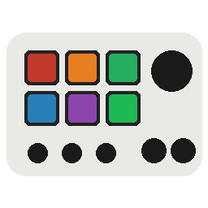

# ajazz-deck



Open-source replacement software for the **AJAZZ AKP03E Stream Dock** (USB `0300:3002`), so you don't
need the vendor's "Stream Dock AJAZZ" app. A small Python program, **deckd**, runs in the background on
Windows. It drives all **6 screen keys, 3 buttons and 3 knobs** (turn and press), and you edit
everything in a local web page.

- **Live tiles:**
  - Now playing: album art, track title, shuffle and repeat state.
  - A clock.
  - "Is this website up?" checks.
  - An optional home-lab status feed.
- **Actions:**
  - Keyboard shortcuts and multi-step sequences.
  - Launching apps and opening URLs.
  - Media controls.
  - System or per-app volume and mute.
  - Switching pages and brightness.
- **Spotify ♥ Like key:** adds the song that's playing to a playlist of your choice. It never adds duplicates, and the heart turns red when the song is already in the playlist.
- **Long press:** any key or button can have a second action on hold.
- **Web editor** at `http://127.0.0.1:8765`. It shows a live picture of the deck; click any control to change it.

> Tested with the **AKP03E rev 2** (firmware `V25.AKP03E.01.004`) on Windows 11. Other Mirabox/AJAZZ
> "N3-family" decks use the same protocol and may work with small changes in `akp03e.py`.

## Install

1. Install **Python 3.10+** from python.org. Tick **"Add python.exe to PATH"**.
2. **Uninstall the vendor app** (Stream Dock AJAZZ) or at least quit it. Two programs can't drive the deck at once.
3. Download this repository (green **Code** button → **Download ZIP**, or `git clone`) and unzip it somewhere permanent.
4. Plug in the deck. Open PowerShell in the folder and run:
   ```powershell
   powershell -ExecutionPolicy Bypass -File .\install.ps1
   ```
   This installs the Python libraries, adds a start-at-login shortcut and starts deckd. On first run it
   creates `config.json` from `config.example.json`.
5. Open **http://127.0.0.1:8765** to edit your buttons.

To stop it and remove the login shortcut, run `.\install.ps1 -Uninstall`.

## Default layout

| Control | Does |
|---|---|
| **Media page** | Album art (play/pause), Previous, Next, ♥ Like, Shuffle, Repeat |
| **Windows page** | Show desktop, Task Manager, Settings, Shut down (**hold**), Explorer, Run |
| **Status page** | Clock, a website up/down check, a web link |
| Left / right button | Previous / next page |
| Middle button | Home page; **hold** to cycle brightness |
| Big knob | System volume; press to mute |
| Small left knob | Spotify's own volume; press to play/pause |
| Small right knob | Skip tracks; press to go to the Media page |

## Spotify Like key (optional)

The ♥ key needs your own (free) Spotify developer app. Nothing is shared with anyone else.

1. Go to https://developer.spotify.com/dashboard and click **Create app**. Any name works. Under **Redirect URIs**
   add exactly `http://127.0.0.1:8765/spotify/callback`, and tick **Web API**.
2. Copy the app's **Client ID**.
3. Find your playlist ID. In Spotify, use **Share → Copy link to playlist**; the ID is the part after `/playlist/` and before `?`.
4. Put both in `config.json`:
   ```json
   "spotify": { "client_id": "YOUR_CLIENT_ID", "redirect_uri": "http://127.0.0.1:8765/spotify/callback",
                "playlist_id": "YOUR_PLAYLIST_ID", "playlist_name": "My playlist" }
   ```
5. Press the ♥ key (or open http://127.0.0.1:8765/spotify/login) and click **Agree**.

Things to know:
- No client secret is needed, because sign-in uses PKCE.
- The sign-in token is stored outside this folder, in `%LOCALAPPDATA%\deckd\spotify.json`.
- Since 2026, Spotify apps in development mode need the app owner to have Premium.

Now playing, play/pause and skip **don't** need any of this. They use Windows' own media controls and work
with any player.

## Tiles you can use

In the editor, choose a **Live tile** for a key, or leave it static (label, glyph, icon, colours).

| Tile | Shows |
|---|---|
| `np_art`, `np_title` | Album art (paused badge) / track + artist |
| `np_like` | ♥ for the Spotify playlist (see above) |
| `np_shuffle`, `np_repeat` | Shuffle / repeat state |
| `clock` | Time and date |
| `url_status` | UP/DOWN and response time for the key's `url` |
| `lab_*` | Optional home-lab numbers from a status JSON (`homelab.status_url`). This is specific to one Homer-based setup, so ignore it unless you adapt the parser in `deckd.py`. |

## Action types

| Type | Fields | Example |
|---|---|---|
| `hotkey` | `keys` | `win+d`, `ctrl+shift+esc` |
| `sequence` | `steps` | `["win+x", "pause:400", "u", "u"]` |
| `run` | `target`, `args` | a program path, or `shell:AppsFolder\<AppID>` |
| `url` | `url` | `https://...` |
| `media` | `cmd` | `playpause`, `next`, `prev`, `shuffle`, `repeat` |
| `page` | `to` | `next`, `prev`, `home`, or a page name |
| `brightness` | `cycle` | `[20, 50, 80, 100]` |
| `volume` (knob turn) | `target`, `step` | `master` or an app exe like `Spotify.exe` |
| `mute` | `target` | `master` or an app exe |
| `track` (knob turn) | none | turn right = next, left = previous |
| `like` | none | adds the current Spotify song to your playlist |

## How the protocol works (for hackers)

The USB protocol comes from the excellent open-source [mirajazz](https://github.com/4ndv/mirajazz) and
[opendeck-akp03](https://github.com/4ndv/opendeck-akp03) projects. MiraBox's
[StreamDock-Device-SDK](https://github.com/MiraboxSpace/StreamDock-Device-SDK) and
[codexdeck](https://github.com/sepivip/codexdeck) were also useful references. The main points:

- Open the HID collection with usage page `0xFFA0`. Every write is a 1025-byte output report (report ID 0, then 1024 bytes).
- Commands start with `CRT\0\0`:
  - `DIS` wakes the deck.
  - `LIG\0\0<0-100>` sets brightness.
  - `BAT\0\0<len hi><len lo><key+1>` followed by the JPEG data sets a key image.
  - `CLE\0\0\0<key+1|0xFF>` clears one key or all of them.
  - `STP` commits changes.
  - `CONNECT` is the keepalive; send it every ~15 s.
- Key images are 64×64 baseline JPEG, rotated 90° clockwise.
- Input reports start with `ACK`. Byte 9 is the control and byte 10 is the state:
  - Keys `1`–`6`.
  - Buttons `0x25 0x30 0x31`.
  - Knob presses `0x33 0x35 0x34`.
  - Knob turns `0x90/91`, `0x50/51`, `0x60/61`.
- **Windows gotcha:** the deck ignores every command, and keeps showing the AJAZZ logo, until the host reads
  **input report `0x01`** (HidD_GetInputReport). That read returns the firmware string. mirajazz skips it on
  Windows, which is why its approach seems to do nothing there. `akp03e.py` does it on connect.

`test_deck.py` is a quick hardware check: it numbers the keys and prints every press and turn.

## Files

| File | What it is |
|---|---|
| `deckd.py` | The daemon: pages, actions, knobs, live tiles, web editor server |
| `akp03e.py` | USB HID driver for the deck |
| `spotify_api.py` | Spotify sign-in (PKCE) and add-to-playlist |
| `editor.html` | The web editor |
| `config.example.json` | Starting layout (copied to `config.json` on first run) |
| `install.ps1` | Installer / uninstaller |
| `test_deck.py` | Hardware test |

## Notes

- **Windows only.** It uses Windows media controls, Windows audio and Windows keyboard input.
- **Editor access:** the editor only listens on `127.0.0.1`, so other devices can't reach it.
- **Not affiliated** with AJAZZ or MiraBox. Use at your own risk.

## License

MIT, see [LICENSE](LICENSE).
